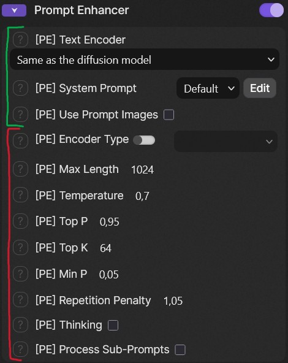

# SwarmUI Prompt Enhancer

Most diffusion models come with a LLM text encoder nowadays,
ComfyUI now has an efficient `Generate Text` node (like ~95% as fast as llama.cpp on optimized models),
but SwarmUI doesn't yet have a way to use it in Generate tab.

This extension fills this gap, letting you use any LLM from your text encoder directory as a prompt enhancer
from the Generate tab of Swarm. As it relies on Comfy only, you benefit from smart offloading, dynamic vram stuff, etc.
instead of having to deal with an external inference engine that will then fight with Comfy for your vram.

The default mode is to reuse the diffusion model's text encoder if it's a LLM, saving some time and moving weights
around.

System prompts library can be managed with the `Edit` button, some LLMs in Comfy have a weird handling of the
chat template, so might not work with every model.

`Use Prompt Images` sends the reference images of your prompt to the `Generate Text`, can be useful for Edit models.

Default sampling values should be sensible for most models, and are accessible with **Advanced Options** toggled on.

*base / advanced params*

## Usage

### During generation

Enable the **Prompt Enhancer** group in the parameters column, set your params, then generate.

The prompt enhancement happens inside the generation workflow: the generated text is plugged into the prompt encoder
node,
and is saved to the image metadata as `Enhanced Prompt` alongside your original `prompt`.
The time spent generating text goes to `Enhancement Time` (all text generations summed, or `cached` when ComfyUI reused
a previous result).

### Pre-Generation

The `✨ PE Enhance` button at the top-left of the prompt box rewrites the prompt in place, without
generating an image. Only the global text before the first section (`<base>`, `<segment:...>`, ...) is rewritten,
sections are kept as-is. In that text, prompt functions (`<wildcard:>`, `<random:>`, `<var:>`, ...) are resolved first;
`<setvar>`/`<setmacro>` are kept silenced so later sections still get their values, and tags acting on the generation
itself (`<lora:>`, `<preset:>`, `<embed:>`, ...) are kept after the enhanced text.
Prompt images are sent too when `Use Prompt Images` is on.

### Captioning

`PE Caption`, in the `More` dropdown next to the active image, describes that image with the prompt upsampler
and replaces the prompt with the description. It uses the built-in `Caption` system prompt, unless you picked
another one than `Default`. Needs a vision-capable LLM (Qwen3-VL, Gemma 3/4, ...).

## Supported models

as of oct. 2026, ping me on Swarm discord if you find others.

### That you may already have as text encoder

- Qwen3
    - 0.6b (Anima)
    - 4b (Z-Image, Klein 4B)
    - 8b (Klein 9B)
- Qwen3-VL
    - 4b (Krea 2)
    - 8b (Ideogram 4)
- Gemma 2 2B (Lumina 2, PixelDiT)
- Gemma 3 12B (LTX-2.x)
- Ministral 3 3B (Ernie)

### Dedicated

- Qwen3.5 family (include 3.6 & 3.8): 0.8B, 2B, 4B, 9B, 27B
- Gemma 4 : E2B, E4B, 12B, 31B

### Not supported

- non-LLM encoders (CLIP, T5, ...)
- Qwen3 32B for MiniMax H3 (the pruned version Comfy shipped & implemented is not capable of generation)
- Qwen2.5 7B for Qwen-Image (misses the output layer)

- Mistral Small 3 24B (Flux2 dev)
- GPT-OSS 20B (Lens)
- LLama3 8B (HiDream)

## Official system prompts and upsampler models

### Image (T2I & I2I)

| Release date | Model              | Lab                  | system prompt                                                                                                                                                                                                                 | officially recommended upsampler model                                                                                                                | Notes                                                                                             |
|--------------|--------------------|----------------------|-------------------------------------------------------------------------------------------------------------------------------------------------------------------------------------------------------------------------------|-------------------------------------------------------------------------------------------------------------------------------------------------------|---------------------------------------------------------------------------------------------------|
| 2025-04      | HiDream-E1         | HiDream.ai           | [HiDream-E1](Upsamplers/HiDream-E1.md)                                                                                                                                                                                        | /                                                                                                                                                     |                                                                                                   |
| 2025-08      | Qwen-Image         | Alibaba Qwen         | [2508](Upsamplers/Qwen-Image-2508.md) / [2512](Upsamplers/Qwen-Image-2512.md) / [2512 (without the examples)](Upsamplers/Qwen-Image-2512-no-examples.md)                                                                      | /                                                                                                                                                     | 2512 system prompt with examples is VERY long                                                     |
| 2025-08      | Qwen-Image-Edit    | Alibaba Qwen         | [Qwen-Image-Edit](Upsamplers/Qwen-Image-Edit.md)                                                                                                                                                                              | /                                                                                                                                                     |                                                                                                   |
| 2025-11      | FLUX 2 Dev         | Black Forest Labs    | [T2I](Upsamplers/Flux2-Dev-T2I.md) / [I2I](Upsamplers/Flux2-Dev-I2I.md)                                                                                                                                                       | `Mistral-Small-3.2-24B` (same as TE)                                                                                                                  |                                                                                                   |
| 2025-11      | Z-Image Turbo      | Tongyi-MAI (Alibaba) | ["Trapped Artist"](Upsamplers/Z-Image-Turbo.md)                                                                                                                                                                               | /                                                                                                                                                     | translated to english                                                                             |
| 2026-05      | HiDream-O1-Image   | HiDream.ai           | [HiDream-O1-Image](Upsamplers/HiDream-O1-Image.md)                                                                                                                                                                            | [Prompt-Refine](https://huggingface.co/HiDream-ai/Prompt-Refine) (finetune of `Gemma-4-31B`)                                                          | translated to english                                                                             |
| 2026-06      | Ideogram 4         | Ideogram             | ["Magic" System Prompt](Upsamplers/Ideogram4.md)                                                                                                                                                                              | /                                                                                                                                                     | [official prompting guide](https://github.com/ideogram-oss/ideogram4/blob/main/docs/prompting.md) |
| 2026-06      | Krea 2             | Krea                 | [Krea 2](Upsamplers/Krea2.md)                                                                                                                                                                                                 | `Qwen3VL-4B` (same as TE)                                                                                                                             |                                                                                                   |
| 2026-09      | Qwen-Image 2.1     | Alibaba Qwen         | [T2I](Upsamplers/Qwen-Image-2.1-T2I.md) / [I2I](Upsamplers/Qwen-Image-2.1-I2I.md)                                                                                                                                             | [PE-T2I](https://huggingface.co/Qwen/Qwen-Image-2.1-PE-T2I) / [PE-I2I](https://huggingface.co/Qwen/Qwen-Image-2.1-PE-I2I) (finetunes of `Qwen3.5-9B`) |                                                                                                   |
| 2026-09      | Ming-Image-0.1     | inclusionAI          | [Ming-Image-0.1](Upsamplers/Ming-Image-0.1.md)                                                                                                                                                                                | `Ling-3.0-flash-VL` or `Qwen3.8-27B`                                                                                                                  |                                                                                                   |
| 2026-10      | FLUX 3 Image Klein | Black Forest Labs    | [T2I-plain](Upsamplers/Flux3-Image-Klein-T2I-plain.md) / [I2I-plain](Upsamplers/Flux3-Image-Klein-I2I-plain.md) / [T2I-bbox](Upsamplers/Flux3-Image-Klein-T2I-bbox.md) / [I2I-bbox](Upsamplers/Flux3-Image-Klein-I2I-bbox.md) | [PUP](https://huggingface.co/black-forest-labs/flux-3-image-klein-pup) (finetune of `Qwen3.5-9B`)                                                     | BFL says not to run Klein without it                                                              |

### Video

| Release date | Model | Lab | system prompt | recommended upsampler model | Notes |
|--------------|-------|-----|---------------|-----------------------------|-------|

### Music

| Release date | Model | Lab | system prompt | recommended upsampler model | Notes |
|--------------|-------|-----|---------------|-----------------------------|-------|

## Notes

- Negative prompts are never rewritten.
- Sections Swarm appends to the prompt for a given stage (`<base>`, `<refiner>`, `<segment>`) are
  kept out of the enhancement: the global prompt is enhanced once, reused by every stage, and the
  section is appended after it (itself enhanced separately if `Process Sub-Prompts` on).
- The generation seed follows your Wildcard Seed when set, and the image seed otherwise.

## License

Do whatever you want with this, Opus did most of it in the first place.